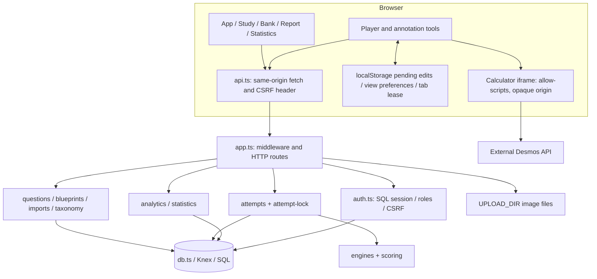
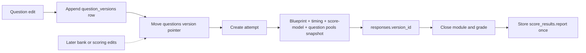

# 03. System architecture

[Context index](README.md)

## Runtime boundaries

The [browser entry](../../client/main.tsx) mounts React. [App](../../client/App.tsx) bootstraps a nullable session and routes views. [api.ts](../../client/api.ts) sends same-origin requests; browser display state is not an authorization boundary. [shared/types.ts](../../shared/types.ts) describes TypeScript payloads, while [validation.ts](../../server/validation.ts), attempt/import schemas and route-specific Zod schemas independently validate untrusted inputs.

[server/index.ts](../../server/index.ts) loads environment configuration, creates/migrates the database, conditionally seeds/bootstrap-creates an administrator and starts [createApp](../../server/app.ts). Route handlers delegate most domain operations to service modules; image storage and some profile/bookmark/error administration remain directly in `app.ts`. There is no separate worker, Redis, queue broker or AI service.

## Authority, cache and reconstruction

| State                   | Authority and durability                                                                                                                                 | Recovery/reconstruction                                                                                                                   |
| ----------------------- | -------------------------------------------------------------------------------------------------------------------------------------------------------- | ----------------------------------------------------------------------------------------------------------------------------------------- |
| Identity/role/session   | SQL `users`/`sessions`; opaque token in HttpOnly cookie                                                                                                  | Browser reboots session through API; no auth token in localStorage                                                                        |
| Question bank           | Mutable `questions` metadata/current version pointer; appended `question_versions.content`                                                               | Prior content versions remain; archive is not historical deletion                                                                         |
| Taxonomy                | SQL `domains` and `skills` for administration/validation/analytics; full-form quotas still use static `DOMAINS` and standard allocations in `engines.ts` | Reload from API; editing SQL taxonomy does not automatically revise full-test quotas; stored report labels can differ from later taxonomy |
| Blueprint definition    | Mutable `blueprints.config`, incremented version counter                                                                                                 | Previous standalone blueprint configs are not retained in a versions table                                                                |
| Started assessment      | SQL attempt snapshot, module state/deadlines and version-bound responses                                                                                 | Fetch/synchronize; reconstruct active view from SQL plus eligible local pending edits                                                     |
| Unsaved edit            | React state and localStorage pending recovery                                                                                                            | Best-effort same-browser replay; storage loss or module expiry can make edits unrecoverable                                               |
| Completed report        | Stored `score_results.report`, once created                                                                                                              | Return saved report; do not silently recompute with today's scorer                                                                        |
| Learning history        | SQL responses/results/errors/bookmarks                                                                                                                   | Dashboard metrics are derived; reasons/mastery/due dates are stored mutable state                                                         |
| Uploaded figures        | Files in `UPLOAD_DIR`; owner metadata in `question_assets`                                                                                               | Database alone cannot reconstruct original file bytes                                                                                     |
| Calculator/presentation | Browser component state                                                                                                                                  | Recreate on mount; calculator work is not part of saved responses                                                                         |

## Historical integrity

[createAttempt](../../server/attempts.ts) captures question content/version IDs for all assembled pools, blueprint configuration, seed, timing and scoring configuration. Only selected modules get installed response rows. Grading/review joins the referenced question versions rather than the latest bank version. Some live question metadata (such as status/owner) is still read during reconstruction; historical integrity chiefly concerns content, answers, form and stored report. This is not full event sourcing or a tamper-proof audit log.

Question updates compare-and-swap the head version read during that request inside a transaction; the submitted editor version is not checked, so a later stale editor can still replace content as a new version. Attempts use [withAttemptLock](../../server/attempt-lock.ts): an in-process per-attempt Promise queue, transaction and PostgreSQL `FOR UPDATE` ownership lookup. SQLite has a single pooled connection with foreign keys/WAL; source does not explicitly issue `BEGIN IMMEDIATE` despite its comment. Serialization does not detect stale client writes: attempts have a database revision counter, but the save contract has no expected revision. Read [persistence](07-state-memory-persistence.md) before changing concurrency.

## File and import boundaries

Multer buffers accepted uploads; image routes inspect supported file signatures, save generated filenames and record owner metadata. `/uploads/*` is publicly served with defensive response headers; authenticated owner-only metadata listing does not make image URLs private. Storage is not embedded in the SQL snapshot and there is no asset deletion API.

[imports.ts](../../server/imports.ts) parses structured input into an owned `import_jobs` preview. The image PATCH updates only that row's image list and recalculates row/image errors. Confirmation revalidates and creates bank questions; it does not fetch HTTPS images. Client preview loading can identify remote display failures. Parser failure and row validation failure are different paths. See [workflows](08-core-workflows.md) and the existing [import contract](../question-import.md).

## Calculator and external services

[Calculator](../../client/Calculator.tsx) hosts `/desmos-calculator.html` with `sandbox="allow-scripts"`, without same-origin permission. [desmos.ts](../../client/desmos.ts) and the [public bridge](../../public/desmos-calculator.js) validate message shapes/source; the parent supplies configuration after the bridge handshake. Wildcard `postMessage` is used because the frame has an opaque origin; source checks are essential.

`app.ts` gives only the calculator document the CSP evaluation allowances required by Desmos. Its script is served with `Cross-Origin-Resource-Policy: cross-origin` for the opaque frame. The main app keeps a stricter policy. The key/version enter the frontend at Vite build time; runtime-only key changes do not rebuild a shipped bundle. External availability and entitlement require separate verification.

## Development and production serving

Vite development port 5173 proxies API, upload and calculator bridge requests to Express on 3001. Production serves `dist` plus a SPA fallback when the built frontend exists; `/assets` also serves original public assets and `/uploads` serves runtime images. The API, static bundle and bridge are same-origin to the user. `HOST`, `PORT`, `APP_ORIGIN`, production cookies and reverse-proxy settings must agree.

SQLite is the default single-process deployment. `DATABASE_URL` selects PostgreSQL (except explicit in-memory test DBs). JSON uses text columns in both adapters. PostgreSQL row locks improve multi-process attempt mutation safety, but do not add cross-device ownership or resolve stale response conflicts. Multiple web instances also need shared uploads, consistent configuration and a strategy for process-local rate limits. See [deployment](13-build-runtime-deployment.md).
