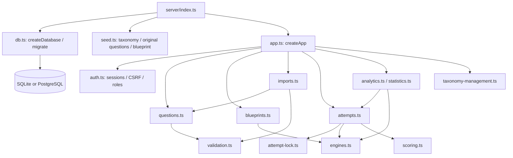
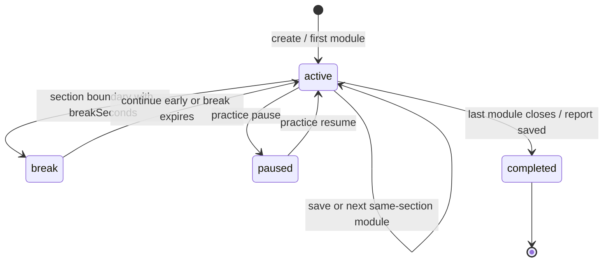

# Backend architecture

[Context index](README.md)

Verified against working TypeScript source on 2026-10-19. This document describes current behavior, not a proposed redesign. Source links resolve from this document. Runtime checks and previous test runs belong in the verification document; no tests were run merely to write this reference.

## Process and dependency boundaries

[`server/index.ts`](../../server/index.ts) is the production/development server entry. It loads dotenv, creates a Knex database, awaits migrations, seeds unless `SEED_SAMPLE_DATA` is exactly `false`, optionally creates a missing administrator from environment variables, then listens on `HOST` (default `127.0.0.1`) and `PORT` (default `3001`). SIGINT/SIGTERM close the HTTP server and destroy the database connection pool. Startup errors propagate; there is no background worker process, scheduler, WebSocket, external AI service, or AgentMemory integration in the application runtime.

[`server/cli.ts`](../../server/cli.ts) provides migration, seed, and administrator commands. All commands migrate first; the CLI destroys its database pool in `finally`. Administrator creation validates credentials with the same registration schema and refuses to replace an existing account. See [`package.json`](../../package.json) for `db:migrate`, `db:seed`, `admin`, and `start` commands. Run from `Works`: several filesystem paths resolve relative to the process working directory.

Types in [`shared/types.ts`](../../shared/types.ts) describe client/server contracts, but do not validate network traffic. Zod schemas in the server remain the authoritative request validation boundary. The runtime schema includes fields not declared on the narrower `Question` interface, notably structured `assets` and `calibration`; do not infer persistence support solely from the interface.

## HTTP composition and ordering

[`createApp(db)`](../../server/app.ts) returns an Express 5 app using injected Knex, which lets tests supply an in-memory database. HTTP handlers delegate most domain work to modules; asset uploads, profile/users, bookmark toggles, and some import HTTP validation live directly in this file.

Middleware/route order is significant:

1. Disable `x-powered-by`; optionally set numeric `TRUST_PROXY`; apply Helmet and main-page CSP.
2. Parse JSON up to `2mb`; parse cookies. Serve the isolated calculator HTML/JS with their special headers.
3. `GET /api/health` performs `SELECT 1` **before** API rate limiting, session lookup, CSRF, and `no-store` middleware.
4. `/api` limiter allows 600 requests per 60-second window; authentication optionally populates the request, CSRF checks mutations, and `Cache-Control: no-store` applies.
5. Nullable-session `/api/me` and `/api/auth/me`, register/login/logout, and **public** `GET /api/taxonomy` are registered.
6. `app.use('/api', authenticated)` gates every subsequently registered API route. Additional roles protect selected routes.
7. API catch-all returns JSON 404, then `/uploads`, public `/assets`, built `dist` files, and SPA catch-all are registered.
8. Central error handler maps Zod to 422, `ApiError` to its status, upload-size errors to 413, other Multer errors to 400, malformed JSON to 400, and other failures to generic 500. Unexpected errors log only the error name.

Do not move fixed `/api/questions/export` behind `/api/questions/:id`. Do not move public taxonomy accidentally behind the authenticated barrier; the client can need it before login. Exact endpoints and request shapes are listed in [API and security](09-api-auth-security.md).

## Module and function map

| Module                                                          | Entry points and responsibilities                                                                                                                                                                                                     | Dependencies / callers                                                                                           |
| --------------------------------------------------------------- | ------------------------------------------------------------------------------------------------------------------------------------------------------------------------------------------------------------------------------------- | ---------------------------------------------------------------------------------------------------------------- |
| [`db.ts`](../../server/db.ts)                                   | `createDatabase`, `migrate`; `json` decodes text/already-decoded JSON, `encode` serializes JSON, `now` produces ISO UTC strings                                                                                                       | All persistent modules; Knex, better-sqlite3, PostgreSQL adapter                                                 |
| [`auth.ts`](../../server/auth.ts)                               | `registerSchema`, `loginSchema`, `createUser`, `makeSession`, `authentication`, `authenticated`, `roles`, `csrfProtection`, `publicUser`                                                                                              | App and startup/CLI; bcryptjs, crypto, Zod                                                                       |
| [`validation.ts`](../../server/validation.ts)                   | `questionSchema`, `responseSchema`, `QuestionContent`, `ApiError`; rich HTML sanitization and image/source URL rules                                                                                                                  | Questions and imports use `questionSchema`; attempts use their own `attemptSaveSchema`, **not** `responseSchema` |
| [`questions.ts`](../../server/questions.ts)                     | `questionQuery`, `toQuestion`, `findQuestion`, `listQuestions`, `createQuestion`, `updateQuestion`                                                                                                                                    | App, importer, attempt assembly; joins current version and enforces visible owner scope                          |
| [`blueprints.ts`](../../server/blueprints.ts)                   | `blueprintSchema`, `saveBlueprint`, `listBlueprints`                                                                                                                                                                                  | App; engines' quota/routing definitions                                                                          |
| [`attempts.ts`](../../server/attempts.ts)                       | `attemptInputSchema`, `attemptSaveSchema`, `createAttempt`, `synchronizeAttempt`, `getAttempt`, `saveAttempt`, `finishModule`, `continueBreak`, `pauseAttempt`, `getResult`, `tutorFeedback`; exported `reviewItems`, `responseValue` | App and analytics; questions, lock helper, engines, scoring, live taxonomy                                       |
| [`attempt-lock.ts`](../../server/attempt-lock.ts)               | `withAttemptLock` serializes per-attempt operations, verifies ownership, wraps in transaction, selects PostgreSQL row `FOR UPDATE`                                                                                                    | Every existing-attempt stateful read/mutation through attempts module                                            |
| [`engines.ts`](../../server/engines.ts)                         | `seededRandom`, `shuffle`, `normalizeNumeric`, `gradeAnswer`, `adaptiveRoute`, `quotaCounts`, `assembleModule`, `assembleByDistribution`, `fullBlueprint`, `estimateSection`, `performance`; routing/scoring model constants          | Pure functions for attempts, seed, analytics, blueprint validation                                               |
| [`scoring.ts`](../../server/scoring.ts)                         | `scoringModelSnapshot`, `scoreSection`; estimated, exact form-mapping, and calibrated-internal engine classes                                                                                                                         | Attempt snapshot/creation/completion; optional scoring JSON file                                                 |
| [`imports.ts`](../../server/imports.ts)                         | `parseFile`, `previewImport`, `patchImportImages`, `confirmImport`, `template`, `exportQuestions`, `TEMPLATE_COLUMNS`; internal decode/fingerprint/image checks                                                                       | App; ExcelJS, CSV parser, questions, schema, taxonomy, local filesystem                                          |
| [`taxonomy.ts`](../../server/taxonomy.ts)                       | Built-in `DOMAINS`, `SKILLS`                                                                                                                                                                                                          | Seed, standard quotas, metadata, import display-name aliases                                                     |
| [`taxonomy-management.ts`](../../server/taxonomy-management.ts) | `loadTaxonomy`, `updateTaxonomy`                                                                                                                                                                                                      | Public taxonomy, admin updates, question/import validation and analytics                                         |
| [`analytics.ts`](../../server/analytics.ts)                     | `history`, `dashboard`, `errorItems`                                                                                                                                                                                                  | Own-user stored results, getAttempt synchronization, performance, taxonomy                                       |
| [`statistics.ts`](../../server/statistics.ts)                   | `statistics` aggregates student identity/activity and shared question performance                                                                                                                                                     | Teacher/admin route; not a student-scoped report                                                                 |
| [`seed.ts`](../../server/seed.ts)                               | `originalQuestions` generates original examples; `seed` inserts taxonomy/content/standard blueprint and creates sample SVG                                                                                                            | Startup and CLI; no fabricated student history                                                                   |

## Ownership and versioning

`questionQuery` always restricts questions to `owner_id IS NULL` or the current user. A student additionally sees only published shared questions, but may see their own drafts/archives. Teachers and admins see shared records of all statuses and their own private records. They do not get automatic visibility into other users' private banks. `public_id` is unique across the entire database, not just an owner.

`createQuestion` validates/sanitizes content, checks domain→section and skill→domain against actual database rows, rejects existing public identifiers, and transactionally inserts a stable question identity plus version 1 content. Students are forced into their private bank. Teacher/admin input can choose private or shared. Only administrators can author `adminNotes`.

`updateQuestion` uses the visible question, checks author authorization, validates a full replacement content object, and performs compare-and-swap on the current version read during that request in a transaction. A successful edit appends a new version, updates indexed metadata and optionally owner scope. A conflicting head change before the conditional update receives 409. The incoming editor version is ignored, so a sequential save from a stale open form can still replace newer content as another version. Non-admin edits preserve the old administrative notes. `DELETE` is logical archive implemented by this same versioned update. There is no hard question-delete endpoint.

Answer secrecy applies to the **active attempt payload**, not the general question library. Students can read answers/explanations in accessible bank records. `findQuestion` and list/export omit admin notes for non-admin users; they otherwise reveal learning content. Do not advertise this as a proctored or adversarially secure exam system.

## Blueprint lifecycle

`blueprintSchema` validates unique section/index/route keys, disjoint manual pools, required matching manual counts, module-1 mixed routing, paired higher/lower module-2 pools, and count/duration limits. Full SAT requires exactly six pools: RW mixed/higher/lower of 27 questions/1920 seconds, Math mixed/higher/lower of 22 questions/2100 seconds.

`saveBlueprint` verifies manual IDs are published, visible to the author, and match the module section. Full forms must use shared questions and standard domain quotas. Teachers may update only their own blueprint; administrators may update any. A stored blueprint has a current config and version counter, but **no blueprint_versions table**. Attempts preserve the config they instantiated. Save is not an optimistic compare-and-swap operation; do not promise concurrent editor conflict prevention here.

Students list published blueprints only. Teacher/admin lists include all blueprints, including unpublished ones. Attempt creation permits a student to instantiate only a published blueprint; author roles can instantiate an unpublished blueprint regardless of its owner. Manual private questions can still make a blueprint unusable by another user when attempt assembly checks visibility.

## Attempt creation and deterministic assembly

`createAttempt` validates custom weighted-domain constraints, chooses a blueprint or `fullBlueprint(seed)`, queries the user's published visible questions (shared only for full mode), and applies requested filters. Weak mode without an explicit domain/skill derives the weakest practiced skill from up to 30 recent saved reports. Wrong/includeWrong uses unresolved `error_logs`; bookmark and exclude-seen modes query the corresponding user-owned records. Tag and source filtering happens after content retrieval.

For a non-full request without a blueprint, it builds a custom blueprint: one section or split RW/Math modules, optional timing, requested/manual counts, and no adaptation unless a blueprint defines it. Full mode snapshots both possible second-module routes. Seeded assembly excludes previously selected IDs across all pools and enforces standard domain quotas where appropriate. Insufficient banks fail with 422; the server does not silently duplicate questions or invent content.

The creation transaction inserts the attempt and runtime modules, activates only the first module, installs its `responses` referencing exact version IDs, and increments question usage when questions are actually installed. It snapshots blueprint, title, break length, time multiplier, scoring config, and **all selected pools with complete question content/version IDs**. Only four modules are played in a standard full SAT even though six alternative pools are selected.

## Attempt state machine and deadlines

`ownedAttempt` always matches both attempt ID and user ID. `getAttempt` is not purely read-only: it calls `synchronizeAttempt`, which advances overdue modules/breaks using their **actual stored deadline/break boundaries** rather than reconnect time. It loops at most ten transitions. No cron is needed for observed deadlines to be enforced. Full-mode pause is rejected; non-full pause records remaining seconds in snapshot and resume shifts the active deadline.

`getAttempt` exposes only active/paused module questions, redacting correct/accepted answers, explanations, hints, strategies, admin notes, calibration, and choice rationales. Pending modules have metadata only. Break/completed payloads have `module: null`. Responses are returned for the active module only.

`saveAttempt` requires active status and matching `moduleId`; it checks question index, response ownership within the active module, MCQ answer/elimination IDs, and highlight ordering. It stores full response states and increments the attempt revision. Time is monotonic per response and capped by elapsed wall time and timed module duration. The server checks highlight ordering but does not verify selected text against source document content.

`finishModule` is aliased by both finish/submit routes. `closeModule` grades pinned versions, locks the module closed, determines a higher/lower route from first-module accuracy, installs the next pool, and either starts the next module, opens an inter-section break, or completes scoring. A supplied stale module ID receives 409; completed/break states are returned idempotently. `continueBreak` can skip the remaining break.

`tutorFeedback` requires tutor mode, persists a response through the normal save validation, grades it immediately, returns the explanation-bearing review item, and records/updates mistake review state. It is deterministic local grading, not an LLM tutoring call.

## Lock and transaction guarantees

| Operation                                         | Transaction / concurrency mechanism                                                                                                 |
| ------------------------------------------------- | ----------------------------------------------------------------------------------------------------------------------------------- |
| Migrations                                        | Each unapplied version is transactional; migration ledger creation is separately guarded by table existence                         |
| Seed                                              | Taxonomy/questions/blueprint writes in one transaction; sample SVG write happens after it                                           |
| Create/update question                            | Stable metadata and new version are transactional; update compares existing version                                                 |
| Existing attempt operations                       | In-process promise queue keyed by attempt ID; transaction verifies owner; PostgreSQL `FOR UPDATE` locks attempt row                 |
| Attempt create                                    | Attempt/modules/first responses/usage transaction                                                                                   |
| Save/finish                                       | Additional nested transactions/savepoints under attempt lock                                                                        |
| Import image repair / confirmation                | Owner-scoped import-job transaction; PostgreSQL `FOR UPDATE`; confirmation report persisted atomically with imported rows           |
| Taxonomy update                                   | All domain/skill upserts in one transaction                                                                                         |
| Asset upload                                      | Exclusive filesystem write, followed by metadata insert; deletes file if insert fails; not a filesystem/database atomic transaction |
| Blueprint save / profile / role / bookmark routes | No multi-operation transaction or version compare-and-swap; role update then session invalidation are separate statements           |

The lock source comment mentions SQLite `BEGIN IMMEDIATE`, but the helper itself calls Knex `transaction` without an explicit immediate-mode statement. The guaranteed source-level mechanism is the in-process queue and configured single SQLite connection; do not infer cross-process SQLite row locks from the comment. Queue failures do not poison subsequent operations and settled queues are removed. Multi-instance deployments need PostgreSQL and shared asset storage; deployment support is not evidence that such a deployment was tested.

## Scoring, result persistence, and analytics

`gradeAnswer` compares MCQ IDs exactly after trimming; SPR allows finite decimals/fractions and relative numeric tolerance `1e-7`. It rejects mixed numbers, expressions, percent/scientific/thousands syntax. `adaptiveRoute` uses default 0.65 accuracy; this is a transparent internal threshold model, not College Board's proprietary adaptive model.

`scoringModelSnapshot` uses default `estimated-linear-v1` (200–800 section score rounded to ten), or validates configured `SCORING_MODEL_FILE`. Exact form mapping requires the precise question IDs **and versions** and one conversion score for each possible raw correct count. The `calibrated-internal` implementation currently inherits that mapping engine; it is not an independent fitted IRT engine. Nonestimated full-mode creation prechecks both potential section forms. Practice returns accuracy with null SAT scores.

Completion stores one JSON `score_results` report per attempt, containing exact review content, model label/version, scores, routes, timing, domain/skill/difficulty performance, and previous full-score delta. Estimated full results include a ±60 total-score display interval bounded to 400–1600; this is an application estimate, not a validated confidence interval. Saved reports are returned rather than silently recomputed. Completing an attempt also updates prior mistake retry/review dates and inserts new wrong-answer entries. Review entries omit admin notes and calibration.

`history` uses up to 500 own results; `dashboard` aggregates up to 1000, optionally filters 7/30/90 days, synchronizes up to 20 open attempts, and recommends unresolved errors or weakest practiced skills. `errorItems` paginates 100 owned historical-version items and filters taxonomy/status/date. Teacher/admin `statistics` is broader: all student identity/activity and up to 1000 shared-question aggregate rows; there is no classroom/tenant association model.

## Import and manual image fallback

The question import flow is detailed in [core workflows](08-core-workflows.md) and the [import specification](../question-import.md). Current implementation is [`imports.ts`](../../server/imports.ts): CSV/JSON/XLSX parse → canonical decode → live-taxonomy/schema/local-image validation → stored preview → optional per-row manual image repair → confirmation → saved report.

The row repair route is **`PATCH /api/imports/:id/rows/:row/images`**, calling `patchImportImages`. It accepts only `{ images: string[] }`, at most ten nonempty URLs of 2000 characters. The current user must own a `preview` job; a demoted student cannot repair an old shared job. It replaces only that row's image array, revalidates row/schema/taxonomy/path errors, refreshes totals, and preserves other content and duplicate decisions. Uploading to `/api/assets` alone does not attach a file: the client must save the resulting URL(s) to the question draft/preview row. A broken workbook itself cannot be repaired at row level until parsing succeeds.

`confirmImport` locks the owner job, returns stored results if already completed, skips invalid/duplicate rows, rechecks local images, and creates each valid question through the normal versioned authoring function. API-level per-question failures become row errors; unexpected failures roll back. Duplicate detection is based on visible existing public IDs and SHA-256 of section + normalized stem + passage, and is frozen during preview. A collision outside that visibility scope can still fail the global public-ID constraint at creation. The flag `skipDuplicates: false` refuses confirmation if duplicates exist; it never permits duplicate insertion.

`/api/assets` sniffs PNG/JPEG/WebP headers, stores UUID-named image bytes in `UPLOAD_DIR` (default `data/uploads`), and records owner metadata in migration-v2 `question_assets`. Original UTF-8 names are display labels, never file paths. `/uploads` is public static serving: metadata visibility is private, bytes are not account-protected. There is no delete API or automatic orphan collector.

## Extension cautions and evidence limits

- Live database taxonomy drives validation/labels/analytics, while standard engine quotas, `/api/meta`, and import label aliases still use built-in constants. Updating taxonomy is not a complete adaptive-form redesign.
- Rich-content validation sanitizes HTML; local image presence checks are importer-specific. Direct question create/update use URL syntax validation without filesystem or remote availability probes.
- HTTPS import images are syntax-checked only, never downloaded; workbook drawings are not extracted by ExcelJS parsing. Manual repair is for per-question media, not automatic PDF/OCR or graph interpretation.
- Session/auth security, public file boundaries, and complete HTTP inventory are in [API and security](09-api-auth-security.md); exact persistence is in [database](06-database-data-model.md).
- Source documentation does not establish current production account counts, database contents, running process state, deployment success, or test status.
