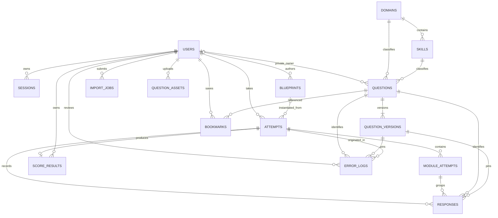

# Database and data model

[Context index](README.md)

Verified from [`server/db.ts`](../../server/db.ts), persistence callers, and [`shared/types.ts`](../../shared/types.ts) on 2026-10-19. Schema below is the schema implemented by source migrations, not a dump of private production data. No account records, credentials, or database contents are included.

## Storage boundary and migration versions

`createDatabase(filename = SQLITE_PATH || './data/sat.sqlite')` selects PostgreSQL if `DATABASE_URL` is set and filename is not `:memory:`; otherwise it uses better-sqlite3. An explicit in-memory filename forces SQLite for tests. PostgreSQL pool is min 0/max 10. SQLite pool is min/max 1, creates the containing directory, enables foreign keys, and uses WAL. Paths are relative to the working directory unless configured absolute.

`migrate` creates `schema_migrations` if absent and applies unapplied numbered migrations in transactions:

| Version | Effect                                                                                                                                                                                             |
| ------- | -------------------------------------------------------------------------------------------------------------------------------------------------------------------------------------------------- |
| 1       | Creates 14 application tables: users, sessions, domains, skills, questions, question_versions, blueprints, attempts, module_attempts, responses, score_results, bookmarks, error_logs, import_jobs |
| 2       | Adds `question_assets`, the user-owned uploaded-image metadata table                                                                                                                               |

There are **16 tables in total**, including the migration ledger. There is no asset-to-question join table, blueprint-version table, classroom table, global memory table, or external provider configuration table.

Knex strings/text, integer, and boolean declarations are portable source types; generated physical SQLite/PostgreSQL types can differ. JSON deliberately lives in text columns, not JSONB. Timestamps are ISO UTC strings supplied by application `now()`, not SQL timestamp columns with server defaults. IDs are strings, generally UUIDs except stable taxonomy IDs and seeded `standard-sat` blueprint. `json` decodes a JSON string or passes through an already-decoded value; `encode` is `JSON.stringify`.

## Relationships

`schema_migrations` is independent and omitted from the ER edges. `question_assets.url` may be copied into question content or import-preview JSON; there is no FK or relational reference that can prevent deleting a referenced asset. Optional parents in the diagram reflect nullable owner/blueprint columns. A question has at least one version by application convention, not a database assertion that a child must exist.

## Complete table dictionary

Notation: `PK` primary key; `FK` foreign key; `UQ` unique; `IX` explicit nonunique index; `?` nullable. Columns without `?` are not nullable. Defaults shown are migration defaults. Only declared indexes are listed; PK/UQ constraints can create additional engine-managed indexes. FKs without an explicit cascade use database default delete behavior.

### `schema_migrations`

| Column       | Type / constraint | Meaning                               |
| ------------ | ----------------- | ------------------------------------- |
| `version`    | integer PK        | Applied migration number              |
| `applied_at` | string            | ISO time written after that migration |

Lifecycle: application-global append ledger; no HTTP exposure or ownership. Migration version transactions insert their own ledger entry after schema creation. No explicit additional indexes.

### `users`

| Column          | Type / constraint         | Meaning                                                      |
| --------------- | ------------------------- | ------------------------------------------------------------ |
| `id`            | string PK                 | User identity                                                |
| `email`         | string UQ                 | Normalized lower-case email from auth schema                 |
| `name`          | string                    | Display name                                                 |
| `password_hash` | string                    | bcrypt hash, cost 12                                         |
| `role`          | string, default `student` | `student`, `teacher`, `admin` enforced by application routes |
| `created_at`    | string                    | Creation time                                                |
| `profile`       | text, default `{}`        | JSON currently containing optional `targetScore`             |

Lifecycle: registration or explicit administrator bootstrapping creates accounts; profile route replaces name/profile; administrator role changes invalidate that user's sessions. No account delete/password-reset endpoint exists. Public serializers omit password hash and profile raw text. The schema itself does not use a SQL enum or role CHECK constraint.

### `sessions`

| Column       | Type / constraint             | Meaning                                   |
| ------------ | ----------------------------- | ----------------------------------------- |
| `token_hash` | string PK                     | SHA-256 of random browser cookie token    |
| `user_id`    | string FK → users.id, CASCADE | Session owner                             |
| `csrf_token` | string                        | Random CSRF value returned to own session |
| `expires_at` | string IX                     | Absolute seven-day expiry                 |

Lifecycle: login/register inserts; authentication selects only unexpired rows; logout deletes the current hash; role change deletes all sessions for a user. Expired rows are ignored, but no scheduled cleanup exists. Raw session cookie tokens are not stored in SQL. There is no explicit index on `user_id` in this migration.

### `domains`

| Column           | Type / constraint | Meaning                             |
| ---------------- | ----------------- | ----------------------------------- |
| `id`             | string PK         | Stable domain identifier            |
| `section`        | string IX         | `rw` or `math` by validation        |
| `name`           | string            | Display label                       |
| `percentage`     | integer           | Approximate distribution percentage |
| `question_range` | string            | Display range                       |
| `position`       | integer           | Taxonomy display ordering           |

Lifecycle: seeded with built-in taxonomy; admin can upsert. Existing in-use domain cannot switch section. Position is retained on update and allocated after current maximum on insert. No domain-delete endpoint; no SQL uniqueness on position or name, and no SQL assertion that percentages sum to 100.

### `skills`

| Column      | Type / constraint      | Meaning                 |
| ----------- | ---------------------- | ----------------------- |
| `id`        | string PK              | Stable skill identifier |
| `domain_id` | string FK → domains.id | Parent domain           |
| `name`      | string                 | Display label           |

Lifecycle: seed/admin upsert; existing in-use skill cannot move domains. No delete endpoint. No explicit domain index beyond any engine-provided FK behavior, no unique `(domain_id, name)` constraint.

### `questions`

| Column        | Type / constraint              | Meaning                                       |
| ------------- | ------------------------------ | --------------------------------------------- |
| `id`          | string PK                      | Stable internal identity                      |
| `public_id`   | string UQ                      | User-facing identifier, globally unique       |
| `section`     | string IX                      | Indexed section                               |
| `domain_id`   | string FK → domains.id, IX     | Indexed current domain                        |
| `skill_id`    | string FK → skills.id, IX      | Indexed current skill                         |
| `difficulty`  | string IX                      | Indexed easy/medium/hard                      |
| `status`      | string IX, default `published` | draft/published/archived                      |
| `owner_id`    | string? FK → users.id          | Null = shared; otherwise private owner        |
| `version`     | integer, default 1             | Current content version number                |
| `usage_count` | integer, default 0             | Number of times installed into played modules |
| `created_at`  | string                         | Creation time                                 |
| `updated_at`  | string                         | Last versioned metadata update                |

Lifecycle: identity metadata changes with edits; edits append a `question_versions` row. Archive is a status-changing versioned update. The current version pointer is an integer, **not an FK** to the composite child key. Database FKs ensure domain and skill exist independently; application validation additionally ensures the section/domain/skill relationship is consistent. No explicit owner or creation-time index. Standard full attempts select shared published records only.

### `question_versions`

| Column        | Type / constraint            | Meaning                                                         |
| ------------- | ---------------------------- | --------------------------------------------------------------- |
| `id`          | string PK                    | Exact immutable version identity referenced by responses/errors |
| `question_id` | string FK → questions.id, IX | Stable parent question                                          |
| `version`     | integer                      | Version number within question                                  |
| `content`     | text                         | JSON validated content, described below                         |
| `created_at`  | string                       | Version creation time                                           |

Unique `(question_id, version)`. Lifecycle: append-only by current write paths; no update/delete route. Database does not enforce immutability with triggers. Seed editorial corrections also append a version. Responses and mistake entries retain version FKs so later edits do not rewrite historical answers/explanations.

### `blueprints`

| Column       | Type / constraint      | Meaning                                       |
| ------------ | ---------------------- | --------------------------------------------- |
| `id`         | string PK              | Blueprint identity (`standard-sat` for seed)  |
| `name`       | string                 | Denormalized config title                     |
| `owner_id`   | string? FK → users.id  | Author; seeded standard blueprint may be null |
| `published`  | boolean, default false | Student visibility                            |
| `version`    | integer, default 1     | Current edit counter                          |
| `config`     | text                   | JSON blueprint definition                     |
| `created_at` | string                 | Creation time                                 |
| `updated_at` | string                 | Last edit                                     |

Lifecycle: teacher/admin author; teacher can update own; admin any. Config is mutable and version counter increments, but old configs do not live in a blueprint history table. Attempt snapshots preserve used configuration. No explicit non-PK indexes or delete route. `name` is not unique.

### `attempts`

| Column             | Type / constraint          | Meaning                                                 |
| ------------------ | -------------------------- | ------------------------------------------------------- |
| `id`               | string PK                  | Attempt identity                                        |
| `user_id`          | string FK → users.id, IX   | Exclusive learner owner                                 |
| `blueprint_id`     | string? FK → blueprints.id | Stored blueprint reference; ad hoc practice may be null |
| `mode`             | string                     | full/module/practice/tutor/wrong/weak/bookmarks         |
| `status`           | string IX                  | active/break/paused/completed                           |
| `seed`             | string                     | Deterministic assembly seed                             |
| `snapshot`         | text                       | JSON content/blueprint/scoring/timing snapshot          |
| `active_module`    | integer, default 0         | Zero-based runtime module position                      |
| `current_question` | integer, default 0         | Current question navigation index                       |
| `started_at`       | string                     | Creation/start time                                     |
| `completed_at`     | string?                    | Report completion time                                  |
| `break_until`      | string?                    | Server-owned end of section break                       |
| `paused_at`        | string?                    | Practice pause time                                     |
| `revision`         | integer, default 0         | Server revision counter; not a client CAS token         |

Lifecycle: learner-owned; inserted with selected content snapshot, then state/timing/navigation mutate under lock. Full mode references `standard-sat` when no explicit blueprint is given, so disabling sample seeding does not itself create that required blueprint. Snapshot's content/config is retained; pause adds/updates `pausedRemaining`, so snapshot text is not literally immutable byte-for-byte. No attempt-delete endpoint.

### `module_attempts`

| Column             | Type / constraint                    | Meaning                                               |
| ------------------ | ------------------------------------ | ----------------------------------------------------- |
| `id`               | string PK                            | Runtime module identity                               |
| `attempt_id`       | string FK → attempts.id, CASCADE, IX | Owning attempt                                        |
| `position`         | integer                              | Zero-based runtime sequence                           |
| `section`          | string                               | rw/math                                               |
| `route`            | string                               | mixed/higher/lower; second route finalized adaptively |
| `status`           | string                               | pending/active/closed                                 |
| `duration_seconds` | integer                              | After time-multiplier accommodation                   |
| `started_at`       | string?                              | Actual activation boundary                            |
| `deadline`         | string?                              | Timed deadline; null for untimed practice             |
| `closed_at`        | string?                              | Lock/grade boundary                                   |
| `routing_result`   | text?                                | JSON decision after first module                      |

Unique `(attempt_id, position)`. Lifecycle: inserted pending/active at creation; route may switch higher→lower before activation; starts and closes at server-controlled boundaries. Attempt owner controls access indirectly. No direct module HTTP resource or deletion route.

### `responses`

| Column          | Type / constraint                    | Meaning                                                 |
| --------------- | ------------------------------------ | ------------------------------------------------------- |
| `id`            | string PK                            | Response identity                                       |
| `attempt_id`    | string FK → attempts.id, CASCADE, IX | Attempt owner path                                      |
| `module_id`     | string FK → module_attempts.id       | Runtime module                                          |
| `question_id`   | string FK → questions.id             | Stable question identity                                |
| `version_id`    | string FK → question_versions.id     | Exact content used                                      |
| `position`      | integer                              | Zero-based display order within module                  |
| `answer`        | text, default empty string           | Choice ID or numeric response text                      |
| `marked`        | boolean, default false               | Review flag                                             |
| `eliminated`    | text, default `[]`                   | JSON choice-ID array                                    |
| `highlights`    | text, default `[]`                   | JSON anchored annotation array                          |
| `notes`         | text, default `[]`                   | JSON note array; current save uses one `id: note` entry |
| `time_spent_ms` | integer, default 0                   | Monotonic capped accumulated time                       |
| `correct`       | boolean?                             | Null until grading; tutor can grade immediately         |
| `updated_at`    | string                               | Last response save                                      |

Unique `(attempt_id, module_id, question_id)`. Lifecycle: installed when a module becomes reachable; mutable only through owner's active-module save; closed modules reject writes. The separate FKs do not assert that version belongs to question or module belongs to attempt; trusted assembly establishes those invariants. SQL has no unique position constraint and no FK to asset URLs.

### `score_results`

| Column       | Type / constraint                    | Meaning                          |
| ------------ | ------------------------------------ | -------------------------------- |
| `attempt_id` | string PK, FK → attempts.id, CASCADE | At most one report per attempt   |
| `user_id`    | string FK → users.id, IX             | Owner for result/history queries |
| `report`     | text                                 | JSON `Result` snapshot           |
| `created_at` | string                               | Report completion time           |

Lifecycle: inserted once on final module closure; returned from saved report without rescoring. App checks for existing result before insert and serializes attempt operations. Historical data is retained; no report edit endpoint. User FK and attempt FK are independent; application ensures same learner.

### `bookmarks`

| Column        | Type / constraint             | Meaning                    |
| ------------- | ----------------------------- | -------------------------- |
| `id`          | string PK                     | Bookmark identity          |
| `user_id`     | string FK → users.id, CASCADE | Owner                      |
| `question_id` | string FK → questions.id      | Stable bookmarked question |
| `created_at`  | string                        | Creation time              |

Unique `(user_id, question_id)`. Lifecycle: toggle route inserts or deletes after question visibility check; list resolves currently accessible current question versions. A bookmark pins identity, not an old version. No explicit additional indexes and no concurrent toggle transaction.

### `error_logs`

| Column            | Type / constraint                | Meaning                               |
| ----------------- | -------------------------------- | ------------------------------------- |
| `id`              | string PK                        | Mistake-review identity               |
| `user_id`         | string FK → users.id, IX         | Owner                                 |
| `question_id`     | string FK → questions.id         | Stable question                       |
| `version_id`      | string FK → question_versions.id | Original mistaken version             |
| `attempt_id`      | string FK → attempts.id          | Originating attempt                   |
| `selected_answer` | text                             | Original wrong response               |
| `reason`          | string?                          | User-selected reason category         |
| `status`          | string, default `new`            | new/reviewing/mastered by application |
| `retries`         | integer, default 0               | Subsequent review/retry counter       |
| `note`            | text, default empty string       | User reflection                       |
| `due_at`          | string                           | Next review date                      |
| `created_at`      | string                           | Original log time                     |
| `updated_at`      | string                           | Last review update                    |

Unique `(user_id, attempt_id, question_id)`. Lifecycle: wrong completion/tutor answers insert once; retries update prior entries, status and due date. Error route lets owner set reason/note/mastered. Original version and selected answer remain available. Due dates are advisory metadata; there is no scheduler or push notification subsystem.

### `import_jobs`

| Column       | Type / constraint    | Meaning                                                                    |
| ------------ | -------------------- | -------------------------------------------------------------------------- |
| `id`         | string PK            | Preview/confirmation job identity                                          |
| `user_id`    | string FK → users.id | Exclusive importing owner                                                  |
| `status`     | string               | preview/completed                                                          |
| `preview`    | text                 | JSON normalized rows, errors, duplicate decisions, totals and hidden scope |
| `report`     | text?                | JSON imported/skipped/row-errors confirmation report                       |
| `created_at` | string               | Preview creation time                                                      |

Lifecycle: parse/preview inserts, manual per-row image patch mutates preview, confirm atomically inserts valid questions and marks completed with report. Reconfirmation returns stored report; repair after confirmation gives 409. No automatic expiry/delete route; original upload bytes are not retained in this table. No extra indexes. Rows use preview labels starting at 2; skipped blank worksheet rows can make these labels differ from original physical XLSX row numbers.

### `question_assets` (migration 2)

| Column       | Type / constraint                 | Meaning                                                   |
| ------------ | --------------------------------- | --------------------------------------------------------- |
| `id`         | string PK                         | UUID also used in generated filename                      |
| `owner_id`   | string FK → users.id, CASCADE, IX | Uploader; restricts metadata listing                      |
| `name`       | string(255)                       | Sanitized original filename for display, Unicode retained |
| `url`        | string UQ                         | Public `/uploads/<uuid>.<png/jpg/webp>` URL               |
| `size`       | integer                           | Uploaded byte length                                      |
| `mime_type`  | string                            | Type derived from magic bytes                             |
| `created_at` | string                            | Upload time                                               |

Lifecycle: authenticated upload writes an exclusive UUID file and inserts metadata; insert failure unlinks the new file. Metadata is mutable only via direct database access; no HTTP rename/delete/garbage collection exists. User-delete cascade removes metadata only, **not the filesystem file**. Asset-list queries are owner-scoped; static file reads are public. The table does not assert usage, link to any question, or represent a secure per-user media bucket.

## JSON content shapes and mutability

| Location                         | Main fields                                                                                                                                                                                                                                                                                                                  | Retention / mutation rule                                                                |
| -------------------------------- | ---------------------------------------------------------------------------------------------------------------------------------------------------------------------------------------------------------------------------------------------------------------------------------------------------------------------------- | ---------------------------------------------------------------------------------------- |
| `users.profile`                  | `{ targetScore?: number }`                                                                                                                                                                                                                                                                                                   | Replaced by profile update; `publicUser` exposes optional targetScore                    |
| `question_versions.content`      | `publicId`, section/domain/skill/type/difficulty, optional difficultyValue, passage/stem, choices `{id,text,rationale}`, correct/accepted answers, explanation/hint/strategy, tags, source/sourceUrl/license/author, images, assets `{url,alt,kind}`, calculator, subskill, adminNotes, optional calibration, status/private | Sanitized/validated full content, append-only version writes                             |
| `blueprints.config`              | Blueprint `id,title,description,kind,published,seed,routingThreshold,routingModelVersion,modules[]`; each module has section/index/route/count/durationSeconds/questionIds                                                                                                                                                   | Current mutable config only; copied into attempts                                        |
| `attempts.snapshot`              | `{blueprint,title,breakSeconds,timeMultiplier,scoringModel?,pools}`; pools keyed `section:index:route`, values `{id,versionId,question}`; optional `pausedRemaining` after pause                                                                                                                                             | Selected content and scoring config preserved; pause metadata can change                 |
| `module_attempts.routing_result` | route/accuracy/correct/total/threshold/modelVersion plus `blueprintVersion` containing whole blueprint object                                                                                                                                                                                                                | Written at routing closure; property name does **not** mean numeric DB blueprint version |
| `responses.eliminated`           | choice-ID array                                                                                                                                                                                                                                                                                                              | Active-module save                                                                       |
| `responses.highlights`           | array of id/field/start/end/text plus color/style/underline/note options                                                                                                                                                                                                                                                     | Active-module save; order/range syntax validation                                        |
| `responses.notes`                | note objects; current client response `note` string stored as `[{id:'note',text:...}]`                                                                                                                                                                                                                                       | Active-module save; serializer returns first note text                                   |
| `score_results.report`           | `Result`: attempt/title/mode/student/completedAt, section/total scores, model label/version, scoreRange, accuracy/correct/total/unanswered/marked/timing, routes, performance arrays, complete review, previousDelta                                                                                                         | Saved once; no silent recomputation                                                      |
| `import_jobs.preview`            | `ImportPreview` plus scope: id/columns/rows/totals; row `{row,question,errors,imageErrors?,duplicate}`                                                                                                                                                                                                                       | Image-only repair revalidates row/totals, preserves other content/duplicates             |
| `import_jobs.report`             | `{imported,skipped,errors:[{row,errors:string[]}]}`                                                                                                                                                                                                                                                                          | Stored confirmation result, reused on repeat confirm                                     |

`questions` metadata is authoritative for current owner/status/version/timestamps in `toQuestion`, overriding overlapping JSON fields. Review assembly sometimes also joins current identity metadata while using historical content. `Question.private` in saved content is not an access-control mechanism; `questions.owner_id` is.

## Critical integrity invariants

1. Stable question identity is distinct from an immutable content version. Never update historical version content to edit a question.
2. Indexed current question metadata and appended version must commit together. `updateQuestion` compares old version to prevent lost edits; database unique `(question_id,version)` provides a second constraint.
3. An attempt's responses point to version IDs selected at assembly; changing or archiving the current question must not change answers in that attempt or saved report.
4. Same-attempt operations must retain `withAttemptLock` and transactional boundaries. PostgreSQL uses row locks; SQLite uses a single connection and an in-process attempt queue. The helper does not explicitly issue the `BEGIN IMMEDIATE` mentioned in its source comment.
5. Closed modules reject edits, full deadlines advance while disconnected, and scoring is performed once. Browser local state is not the grading authority.
6. Ownership queries must scope learner records by user ID and visible questions by null/current owner. Global public identifiers remain unique even across private banks.
7. Import repair changes only row images and validation metadata. Confirmation rechecks local image files and uses ordinary question creation, rather than inserting unchecked content.
8. Upload URL reuse in content is plain text. File existence and database rows cannot be kept consistent by FK constraints; backup and cleanup need both stores.

## Seed and taxonomy cautions

[`seed.ts`](../../server/seed.ts) inserts built-in domains/skills with conflict-ignore, 44 original demonstration questions per eight domains (352 initial examples), and the standard blueprint. Existing untouched version-1 generated examples can receive editorial fixes as a new version 2; records already edited beyond version 1 are retained. The sample SVG is written outside the seed database transaction. This source count is not a claim about today's populated bank.

Live taxonomy can be upserted by admin and is used for validation/display/performance. Standard engine quotas, built-in metadata, and import display-name lookup still use [`taxonomy.ts`](../../server/taxonomy.ts) constants. Rename/add operations do not automatically redefine standard adaptive pools. Old JSON snapshots may retain old labels/IDs as historical content.

## Backup, portability, and known limits

- Back up the actual database plus the configured upload directory together. A question JSON export does not include users, attempt history, sessions, assets, or an entire recoverable database. WAL-aware/online SQLite backup matters if the server is writing; copying only a live main database file can omit WAL state.
- No automatic DB backup, migration downgrade, archive purge, import purge, expired-session collector, or orphan-image collector is implemented by these modules.
- PostgreSQL is a real code path, but schema portability is not a claim of a currently provisioned or tested PostgreSQL instance. `DATABASE_URL` is a secret; do not reproduce its value in context packs.
- Most enum/range/relationship rules live in Zod/application code rather than SQL CHECK constraints. Direct SQL writes can violate assumptions despite simple FKs.
- No classroom/organization tenancy exists. Teacher/admin statistics intentionally aggregate students across this app installation.
- [Backend architecture](05-backend-architecture.md) explains transactions and state transitions; [API and security](09-api-auth-security.md) describes access controls and public media behavior.
