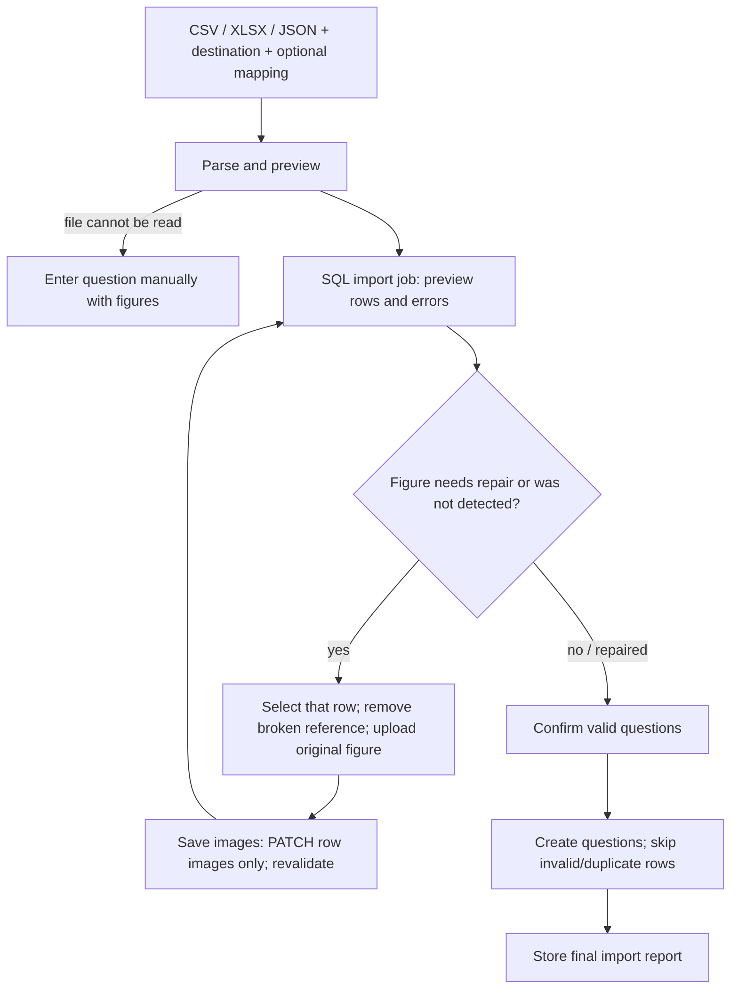
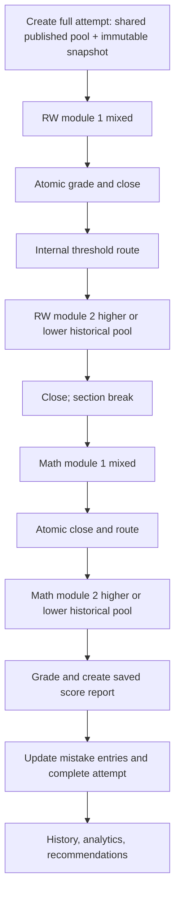

# Core workflows

[Context index](README.md) · [State/recovery](07-state-memory-persistence.md) · [Assessment engine](10-assessment-engine.md) · [Learning history](11-analytics-learning-memory.md)

Steps below describe the current UI and service calls. Route paths shown without `/api` are passed through the client's API helper. They are not a substitute for server permission checks. Files linked here are implementation entry points, not claims that browser tests were rerun for this documentation task.

## Authentication and account changes

Sources: [`client/App.tsx`](../../client/App.tsx), [`client/api.ts`](../../client/api.ts), [`server/auth.ts`](../../server/auth.ts), [`server/app.ts`](../../server/app.ts).

```mermaid
sequenceDiagram
    participant B as Browser/App
    participant A as Auth API
    participant D as SQL
    B->>A: GET /me + GET /taxonomy at boot
    A->>D: Look up hashed cookie token, unexpired session, current user
    A-->>B: User + CSRF token, or unauthenticated
    B->>A: POST /auth/register or /auth/login
    A->>D: Create student / verify password; insert session
    A-->>B: HttpOnly session cookie + user/CSRF
    B->>A: GET /me via refreshUser
    Note over B,A: Mutations send cookie and X-CSRF-Token
    B->>A: POST /auth/logout
    A->>D: Delete current session
    A-->>B: Clear cookie; App returns to auth form
```

1. **Register:** Auth form collects name/email/password. `registerSchema` normalizes the email, enforces name/password constraints, and `createUser` creates a student with a bcrypt password hash. A duplicate email returns a conflict. Self-registration cannot select a privileged role.
2. **Login:** Server verifies normalized email and bcrypt hash, creates a seven-day session, stores the token's SHA-256 hash, and sets the `sat_session` HttpOnly cookie. Credentials/session tokens are not put in localStorage.
3. **Session validation:** Authentication middleware checks the cookie/session expiry and joins the current user on requests. `/me` supplies frontend identity/CSRF state; the client refreshes this after login and profile save. There is no automatic global route redirect on every later API 401; pages surface API errors until the user refreshes/signs in again.
4. **Logout:** POST requires an authenticated session and CSRF protection, deletes this session, clears cookie, resets App's user, and navigates home. It does not delete account history or enumerate local attempt-recovery keys.
5. **Profile:** Settings PUTs name/target score to `/profile`, then reloads `/me`. Email is displayed read-only in this form.
6. **Role change:** An administrator uses User management to PUT a student's/teacher's/admin's new role. The server validates the role, prevents an admin from removing their own administrator role, and deletes all sessions for the affected account. The person must sign in again. UI role visibility is not sufficient authorization.

There is no email-verification, password-reset, or password-change flow in this implementation.

## Question lifecycle

Sources: [`client/Bank.tsx`](../../client/Bank.tsx), [`server/questions.ts`](../../server/questions.ts), [`server/validation.ts`](../../server/validation.ts).

1. **Create:** Question library → Add question opens `QuestionEditor`. The author supplies section/domain/skill, type/difficulty, passage/stem/choices or numeric accepted answers, explanations/provenance/license, and status. The server validates and sanitizes content, checks taxonomy relationships and public-ID uniqueness, inserts a `questions` head and version 1 in `question_versions` transactionally.
2. **Choose scope:** Students create only private questions, enforced server-side regardless of manipulated client scope. Teacher/admin users may author shared content or their own private content. Other users' private content is excluded by `questionQuery`; staff status does not automatically expose every private bank.
3. **Attach a figure by hand:** The question editor's **Images and charts** section uploads through `/assets` and appends URLs to its draft. The author must still save the question. A successful file upload is not a saved question.
4. **Edit/version:** PUT `/questions/:id` checks edit authorization, validates content/taxonomy, uses a head-version compare-and-swap, increments the head version, and inserts a new version. Earlier attempt responses remain linked to earlier version IDs.
5. **Publish:** Set status to published and save through the same versioned update. Published visible questions are eligible for assembly; strict full SAT uses published shared questions only. A draft is not an assessment-ready question merely because it appears in its owner's library.
6. **Archive:** The archive control DELETEs `/questions/:id`; the handler performs `updateQuestion` with archived status, creating another version. It does not physically delete historical response/version records or upload files.
7. **Export:** The library downloads authorized question content as JSON via `/questions/export`. Student export is limited to their private collection; shared export requires an author role. Export does not include attempt/account history or bundle upload bytes. Full backup needs database plus uploads.

Retrying a question later uses its currently published visible version during new assembly. The historical report/journal still displays its linked old version. These two workflows intentionally have different time references.

## Import and manual per-row figure fallback

Sources: `ImportQuestions` in [`Bank.tsx`](../../client/Bank.tsx), [`QuestionImages.tsx`](../../client/QuestionImages.tsx), [`server/imports.ts`](../../server/imports.ts), asset/import routes in [`app.ts`](../../server/app.ts). See also the user-oriented [question import guide](../question-import.md).



1. Open **Question library → Import**, select CSV/XLSX/JSON (up to the request's 5 MB limit), choose private/shared destination, optionally map canonical field names to source column names, then **Parse & preview**.
2. `parseFile` reads JSON arrays or `questions`, headered CSV, or **only the first XLSX worksheet**. XLSX uses row 1 headers and cell text. Drawings/pictures pasted over cells are not extracted. Invalid workbook decoding produces **Invalid XLSX workbook**. Data-URI strings, local Windows paths, and bare figure filenames are not supported image URLs.
3. `previewImport` decodes rows, validates schema/taxonomy and local image references, detects duplicate public IDs/content, stores an `import_jobs` preview, and returns row errors/counts. No bank question has been created at this point. Preview row numbers are `index + 2` after parsed rows are collected; if blank spreadsheet rows were skipped, do not assume this is a preserved physical worksheet coordinate.
4. Inspect figures in each row. Use **Repair images** for invalid/unavailable figures, **Attach images manually** if none was detected, or **Edit images** for an existing attachment. Text-only questions need no attachment action. This is a manual fallback attached to one question, not a required separate image-library preparation workflow.
5. In that row editor, remove broken references and upload the original PNG/JPEG/WebP image/graph (5 MB each, at most 10 per question). Uploads POST `/assets`; the returned URLs enter a local draft list. Users can inspect previews, cancel the draft, or **Save images**. While uploading/saving, controls prevent conflicting row actions/closing.
6. Save PATCHes `/imports/:id/rows/:row/images` with an images-only strict payload. The server verifies job ownership, preview status, destination authorization, schema and local paths; changes only that row's image list, recomputes its errors/totals, and preserves other content and duplicate decisions. It does not rewrite the spreadsheet or generate academic content.
7. Resolve outstanding errors or allow invalid rows to be skipped. Browser thumbnail failures on an otherwise-ready row block the UI confirm button until repaired/removed. The server validates local references again during confirmation, but does not download/check remote HTTPS image bodies. A remote URL's future availability is outside the import guarantee.
8. **Confirm valid questions** POSTs `/imports/:id/confirm` with duplicate skipping enabled. The server uses the job's stored destination, creates valid nonduplicate questions, records skipped/errors, and stores the final report. Reconfirming a completed job returns its saved report rather than importing twice.

When the whole file cannot parse, **Enter question manually** opens authoring so the user can supply the question/figures themselves. Row repair cannot repair arbitrary question text or answer schema errors. Cancelled image drafts/imports can leave already-uploaded bytes; there is no automatic delete of those uploads. Figure links are accessible to anyone with the link even when the question is private. Back up the configured upload directory and metadata together.

## Reusable test blueprint

Teacher/admin workflow: **Test builder → Build a test** opens `BlueprintEditor`, choose full/custom kind, title/description/seed, configure module pools/timing/routing threshold, search/select/reorder published questions, and save. Full SAT configuration has mixed first modules and alternate lower/higher second-module pools. Custom mode supports flexible module counts and time. Authors can duplicate or publish/unpublish cards; students see published blueprints and can launch them, but cannot write them.

**Start test** creates an attempt with `blueprintId` and `mode: full` for a full blueprint or `mode: practice` for custom. `createAttempt` copies the chosen configuration/questions/scoring model into the attempt; editing the blueprint afterward does not mutate the attempt. Blueprint validation is in [`blueprints.ts`](../../server/blueprints.ts), while assembly/availability checks remain in `attempts.ts`.

## Practice attempt

Sources: `Practice` in [`Study.tsx`](../../client/Study.tsx), [`Player.tsx`](../../client/Player.tsx), [`attempts.ts`](../../server/attempts.ts).

1. **Configure:** Choose tutor, custom practice, timed module, full simulation, wrong, weak, or bookmarks. Controls provide section/domain/skill/difficulty, count, timing, accommodation multiplier, seed, tags/source, unseen/wrong constraints, and optional custom domain distribution where allowed.
2. **Assemble:** POST `/attempts` validates mode/input and filters published questions visible to this user. Explicit question IDs, bookmark/wrong collections, weak-skill history, and filters affect the pool. Wrong/weak/bookmarks cap requested count to available items; empty collections fail explicitly. Mixed-section custom practice can become separate RW and Math modules.
3. **Start:** Server creates the immutable content/configuration pool snapshot, active/pending module rows, and response rows for the first active module. Player loads only its active questions with answer/explanation fields redacted.
4. **Answer/autosave:** Choices/numeric response, flags, elimination, highlights/notes and navigation update locally, enter the local recovery queue, and PATCH the active module. See [exact recovery mechanics](07-state-memory-persistence.md).
5. **Tutor feedback:** **Check answer** flushes pending changes then POSTs `/attempts/:id/tutor`. Only tutor mode permits immediate correctness/explanation disclosure. The server saves/grades against the historical version and may update a mistake record; feedback is transient in Player and can be requested again after reload. Final report is still produced by module completion.
6. **Pause/resume:** Explicit non-full pause flushes changes, records server remaining seconds and paused status; resume rebases deadline. Closing/exiting alone does not pause. Strict full mode rejects pause. Save-and-exit waits for a successful flush before returning to the dashboard.
7. **Submit:** Review the module and confirm submission. The client flushes first, sends active `moduleId` to finish, and resets per-module UI. Server grades/closes and advances or produces a result. Closed modules cannot accept further answer edits.
8. **Review:** Completion navigates to `/results/:id`. Non-full attempts report accuracy rather than a full SAT score; their evidence still contributes to history/analytics.

## Full adaptive SAT

Default structure: RW 27 questions/32 minutes twice, then Math 22 questions/35 minutes twice, with a default 10-minute section break. Timing multipliers and break configuration are explicit inputs. The adaptive rule/model and scores are Pathwise internal approximations, not College Board's proprietary calibration/routing.



1. `createAttempt` validates full-kind blueprint and published shared question availability, builds deterministic pools from seed, avoids repeats across candidate pools, snapshots scoring configuration, and creates four learner-module rows (alternate route pools are not all active modules).
2. Learner completes the first mixed RW module, or the server later observes its deadline expired. `withAttemptLock`/transaction wraps grading, close, routing result, next-pool installation and position update.
3. `adaptiveRoute` compares module-one correctness fraction to the blueprint threshold (default 0.65). The built-in blueprint's routing model string is `accuracy-threshold-v1`; a newly opened `BlueprintEditor` currently defaults its metadata to `accuracy-v1`. Closing stores the snapshot blueprint's model string with the routing evidence; the actual route calculation is still `adaptiveRoute`. The selected higher/lower RW second module starts; module one is closed.
4. Closing RW module two prepares Math module one and enters the configured section break. Learner may continue early; otherwise server derives the Math start from break-until. The same module-one route rule selects Math module two.
5. After final close, `scoreResult` uses attempt-snapshotted scoring configuration and historical response versions, stores report/model metadata once, updates error logs, and sets completed status.
6. On reconnect/GET after long absence, `synchronizeAttempt` advances expired boundaries rather than granting a fresh module duration. This can close multiple modules and complete the test without the browser having been online. Browser display countdown is not authoritative.

## Annotation and notes workflow

1. Turn on **Highlights & Notes**. Mode is off on each mount/refresh even though stored annotations remain.
2. Select prose within passage or stem; `captureTextSelection` records sanitized prose offsets/excerpt, excluding generated math nodes. The palette adds/edits a highlight, color, underline style, or note. The player rejects overlapping new annotations and enforces limits.
3. **Add note** saves `noteAttached: true` on the highlight and opens its inline excerpt card. Typing calls `changeNote` and the normal response save queue; no separate notes endpoint is used.
4. Deleting a note clears text/attachment while preserving the highlight; deleting a highlight removes that annotation and its attached note. Turning off the mode or closing the panel preserves saved data.
5. The notes panel appears only for questions with attached notes and can be resized. Open/width preferences are local; note content is in response SQL/history. Reload restores annotations from the version-linked response, but the user turns the mode back on to edit them.
6. Completed report JSON retains annotations/attached notes, but the current report review UI only displays the legacy general question note. It does not reconstruct saved highlights or attached-note cards there. The stored data remains available for a future presentation improvement; closed attempts stay read-only.

Implementation spans [`RichText.tsx`](../../client/RichText.tsx), Player's annotation functions, [`AnnotationToolbar.tsx`](../../client/AnnotationToolbar.tsx), [`NotesPanel.tsx`](../../client/NotesPanel.tsx), and [`NotesResizeHandle.tsx`](../../client/NotesResizeHandle.tsx).

## Mistake journal, retries, and review scheduling

On completed scoring, every incorrect/unanswered review item can create a version-linked `error_logs` row unique to user/attempt/question. For the same question, prior entries have retries incremented and status/due dates updated: later correct work moves unmastered entries to reviewing with a three-day due date, while wrong work sets new status with one day due. Explicit mastered status is retained on a later correct retry; a later incorrect result can reopen it. Tutor feedback also updates mistakes before final completion.

The journal GETs `/errors`, supports section/domain/skill/difficulty/date and status filters, and opens a `QuestionReview` for the original version/selected answer. The user assigns a reason or marks mastered/reopens via PUT `/errors/:id`. **Practice my mistakes** starts `mode: wrong` over unmastered question IDs; an individual retry starts ordinary practice with that question ID. The selected journal filters are not forwarded to the collection-attempt request, so do not assume only the displayed page/filter is retried.

Due dates are stored, but the UI/assembly does not enforce a due-only queue or send scheduled notifications. A retry is a new attempt over currently available published content; it is not editing the prior saved response. The journal API accepts a note field but `ErrorItem`/the current journal UI do not expose a journal-note editor.

## Bookmark and weak-skill practice

- **Bookmarks:** `QuestionReview` toggles `/bookmarks/:questionId`. Practice Studio's saved-question mode requests `mode: bookmarks`; server intersects user bookmark IDs with published visible questions, assembles the collection and caps count. A bookmark points to the question, not a frozen version.
- **Weak skills:** Dashboard derives weakest attempted skills from saved result evidence, sorts by accuracy then slower time, verifies available questions, and supplies recommendation links. Practice mode `weak` without an explicit domain/skill selects the weakest attempted skill from the latest 30 saved reports. These are deterministic heuristics, not AI diagnosis. Explicit filters still constrain available questions.
- **Recommendations:** Active mistakes may prepend a wrong-question suggestion; without usable skill/mistake recommendations the dashboard suggests a timed module. Recommendation count is capped by collection availability; clicking configures/starts a normal server attempt flow.

## Reports, history, analytics, and staff statistics

1. Completing a module/attempt persists response grades and, at completion, `score_results.report`. Fetching `/attempts/:id/result` synchronizes lifecycle first, verifies ownership, and returns stored report JSON; an unfinished attempt gets a conflict.
2. `Report` displays saved score/accuracy, model label/version, domain/skill/timing/route evidence and review. Filters include wrong, marked, unanswered, slow (>90 s) and rapid (<3 s answered). Retry creates another attempt; bookmark toggle changes only the user's collection.
3. Both **Print report** and **Save as PDF** invoke `window.print()` and print CSS. No server PDF report is generated.
4. Overview/Progress & history query dashboard/history data from saved reports. Dashboard calls can also synchronize unfinished attempts, so a read can close expired sessions. Analytics are reconstructed from stored evidence with bounded history queries, not an independent mutable ability record.
5. Authorized teachers/admins open Student statistics to read aggregate participation and shared-question performance. This page does not grant private-question visibility or allow editing other students' attempts. See [API/auth](09-api-auth-security.md) and [analytics](11-analytics-learning-memory.md) for exact authorization/query scope.
