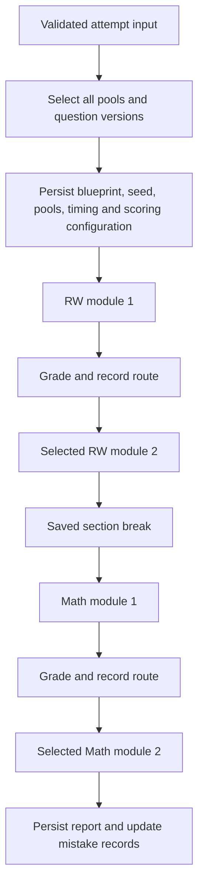

# Assessment engine

[Context index](README.md) · [State and persistence](07-state-memory-persistence.md) · [Analytics](11-analytics-learning-memory.md)

Inspected against current source on 19 October 2026. The authoritative implementation is [attempts.ts](../../server/attempts.ts), supported by [engines.ts](../../server/engines.ts), [blueprints.ts](../../server/blueprints.ts), [scoring.ts](../../server/scoring.ts), and [shared types](../../shared/types.ts).

## Public structure and internal assumptions

The standard simulation follows the public Digital SAT layout: Reading and Writing has two 27-question, 32-minute modules; Math has two 22-question, 35-minute modules; the default section break is 600 seconds. A student answers 98 questions across four modules. This is a practice implementation with original sample content, not an official SAT delivery or scoring system.

The routing threshold, difficulty selection, raw-score conversion, illustrative score range, and seven-segment performance bars are Pathwise rules. No confidential College Board item parameters, equating, percentile calculation, or unscored pretest-item model is bundled. Existing [SAT specification](../sat-spec.md) is useful background, but implementation details below are verified from code.

## Blueprints and strict versus custom modes

`fullBlueprint()` creates six pool definitions: mixed module 1, higher module 2, and lower module 2 for each section. Both alternatives are assembled before the attempt starts, although only one module-2 alternative in each section is taken. This requires 147 distinct questions in the snapshot: 81 RW and 66 Math.

`blueprintSchema` validates module keys, route/index combinations, counts, timing, and manual selections. A `kind: full` blueprint must contain exactly these six pools with standard counts and durations. Module 1 uses `mixed`; an adaptive module 2 requires module 1 and both higher/lower alternatives in that section. Manual `questionIds` must match their pool count, and IDs cannot repeat across pools. Full manual forms also require shared published questions with standard domain quotas. `saveBlueprint()` checks section and availability and restricts teacher edits to their own blueprints; API roles are enforced in [app.ts](../../server/app.ts).

The attempt's `mode` and blueprint's `kind` are distinct. `mode: full` requires a full blueprint, restricts assembly to the shared bank, enables section scores, and rejects pause. A non-full mode can use a blueprint or a generated custom practice definition. Do not assume that using a standard-shaped blueprint alone grants strict full-test behavior.

Without an explicit blueprint, non-full modes generate practice modules:

| Mode                | Assembly behavior                                                                                                                                          |
| ------------------- | ---------------------------------------------------------------------------------------------------------------------------------------------------------- |
| `module`            | One selected section; 27 RW or 22 Math questions, standard module duration; domain quotas enforced unless domain/skill/difficulty filters narrow the pool. |
| `practice`, `tutor` | Requested IDs/count, optional timing, optional filters; tutor additionally permits immediate grading and explanations.                                     |
| `weak`              | Explicit skill/domain if supplied; otherwise weakest measured skill from up to 30 latest saved reports. Count shrinks to available questions.              |
| `wrong`             | Questions with at least one owned, non-mastered error log; count shrinks to availability.                                                                  |
| `bookmarks`         | Owned bookmarks; count shrinks to availability.                                                                                                            |

Other filters include section, domain, skill, difficulty, all supplied tags, exact source, and `excludeSeen`. Seen means a response row in any owned attempt, including an unfinished attempt. Practice without a section can split into RW and Math modules; requested timing is divided in proportion to question count. With no timing, practice duration is zero and no deadline is created. A request without a seed receives a random UUID seed.

## Deterministic assembly

`seededRandom()` hashes the seed and produces a deterministic PRNG; `shuffle()` uses Fisher–Yates. Determinism assumes the same input bank, ordering, versions, filters, and seed. `createAttempt()` orders the bank by public identifier before assembly. Editing the bank or applying different exclusions changes the result even with the same seed.

`assembleModule()` filters to published questions in the requested section and excludes every ID already assigned to another pool. Selection differs by route:

- `mixed`: approximately one-third easy, medium, and hard; any unavailable difficulty allocation is filled from remaining candidates.
- `higher`: hard first, then medium, then easy.
- `lower`: easy first, then medium, then hard.

Higher/lower are difficulty preferences, not strict difficulty-only pools. A shared exclusion set makes all six full-test pools disjoint. Insufficient counts or domain quotas fail with HTTP 422; the engine does not silently reduce a full test. The comment in `engines.ts` referring to “all five blueprint pools” is stale: the actual blueprint and tests use six.

Standard module quotas are complementary:

| Section/domain order from taxonomy                                                                | Mixed module 1 | Either module 2 | Taken section total |
| ------------------------------------------------------------------------------------------------- | -------------- | --------------- | ------------------- |
| RW: Information and Ideas, Craft and Structure, Expression of Ideas, Standard English Conventions | 7, 7, 6, 7     | 7, 8, 5, 7      | 14, 15, 11, 14      |
| Math: Algebra, Advanced Math, Problem-Solving and Data Analysis, Geometry and Trigonometry        | 8, 7, 4, 3     | 7, 8, 3, 4      | 15, 15, 7, 7        |

Other counts use taxonomy percentages and largest remainders. `assembleByDistribution()` supports positive relative domain weights in a selected practice section. It normalizes weights and resolves fractional ties by domain ID. Custom distributions are rejected for full/module mode, supplied blueprints, or manual-ID selections.

## Snapshot and lifecycle

The snapshot stores the blueprint, seed, question content and immutable version IDs, break duration, time multiplier, and scoring model. Response rows reference `question_versions`; later question edits cannot alter their answer keys or rich content. Only the initial active pool is installed into responses at creation. Selected later pools are installed on transitions and increment `questions.usage_count`; the unused adaptive alternatives remain in the snapshot.

`withAttemptLock()` surrounds synchronization and writes with an attempt transaction. `closeModule()` grades all installed responses using their versioned keys, closes the module, records routing if needed, chooses/installs the next pool, and either starts the next module or enters the break. Completed attempts create one stored result. Active responses returned by `getAttempt()` redact answer keys, explanations, hints, strategies, administrative notes, calibration, and choice rationales; tutor feedback is a separate guarded path.

## Routing and deadlines

`adaptiveRoute()` implements `accuracy-threshold-v1`: `correct / total >= threshold` selects `higher`; otherwise `lower`. Default threshold is 0.65, editable per blueprint within 0–1. Empty responses are incorrect. Routing records correct count, total, accuracy, threshold, configured model-version label, and the blueprint snapshot on module 1. The model-version string is metadata; it does not select a separate routing implementation.

Server timestamps own deadlines. Durations are multiplied by the supported 1, 1.5, or 2 accommodation choice. `synchronizeAttempt()` lazily advances expired modules and breaks when an attempt is read or changed; there is no background timer worker. It uses each actual deadline/break boundary, so a long offline interval can close multiple modules rather than granting fresh time on reconnect. Late saves synchronize first and reject the old module. `finishModule()` accepts explicit early submission. `continueBreak()` allows early break completion, including in full simulation; this is a practice convenience, not actual test-day policy. `pauseAttempt()` rejects every full-mode pause and persists remaining practice time for non-full resume.

## Numerical grading

`normalizeNumeric()` lives in `engines.ts`; there is no separate numeric module. It trims whitespace, normalizes Unicode minus, accepts signed finite decimals and integer fractions, and rejects zero denominators, mixed numbers, expressions, percentages, scientific notation, thousands separators, NaN, and Infinity. MCQ grading compares the trimmed answer to the exact choice ID. SPR grading compares the parsed number to each accepted answer with fixed tolerance `max(1, abs(accepted)) × 1e-7`.

No authored tolerance field is used by the current grader. The older `docs/sat-spec.md` phrase “optional authored numerical tolerance” describes more than the implementation provides. Do not introduce a configurable tolerance through documentation alone.

## Scoring and saved reports

`scoringModelSnapshot()` reads trusted `SCORING_MODEL_FILE` JSON if configured; otherwise it selects `estimated-linear-v1` with label **Estimated SAT Score**. Estimated section score is the nearest ten to `200 + 600 × correct / total`, clamped to 200–800. Unanswered responses count in the denominator. Only full mode receives section and total scores; other modes show practice accuracy. There is no route cap. The estimated total's ±60 range, clipped to 400–1600, is illustrative and has no calibrated confidence interpretation.

The supplied `form-mapping` and `calibrated-internal` strategies both use exact-form lookup: section, complete set of question IDs, and every question version must match. A form supplies one 200–800 integer for each correct count from zero through N. Full-test creation checks mappings for both possible routes of both sections before permitting an attempt. A missing form fails closed with HTTP 422. `CalibratedInternalScoringEngine` currently subclasses the same lookup strategy; it is not a fitted IRT engine.

`scoreResult()` persists the complete report in `score_results.report`: exact review questions and answers, grades, timing, counts, routes, model label/version, domain/skill/difficulty summaries, and prior-full-score delta. `getResult()` returns the stored JSON rather than rescoring. For new attempts the model is snapshotted; a compatibility fallback reads current scoring configuration only if an older snapshot lacks it. Historical report scores must remain unchanged when grading/scoring code evolves.

Tests for this boundary are mapped in [Testing and verification](12-testing-verification.md).
