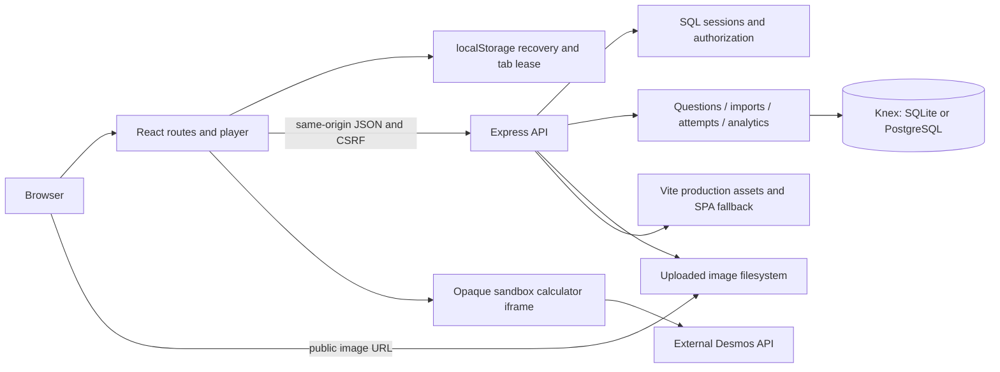

# Pathwise: AI and developer context

Source review: **19 October 2026**, current working tree based on Git `585cb62`. This pack includes the working manual image-repair implementation, including untracked source/tests. It describes implementation, not a claim that every deployment or external integration has been exercised. Source wins when documentation drifts.

## Project identity

**Pathwise / Digital SAT Studio** is an independent self-study application: assess → analyze → targeted practice → review mistakes → reassess. Students take assessments, author private questions, bookmark content and track learning history. Teachers manage shared questions/forms and view aggregate statistics. Administrators additionally manage users, roles and taxonomy.

The product includes a focused Bluebook-like player, adaptive full-test simulation, custom/tutor practice, versioned question authoring, CSV/XLSX/JSON imports and JSON export, per-row manual image repair, persisted reports, mistake review and rule-based recommendations. It is not affiliated with College Board; internal routing, knowledge levels, score estimates and fallback calculator are not official SAT systems. Desmos availability and entitlement depend on operator configuration and the external service.

## Verified stack

Versions below are resolved in [package-lock.json](../../package-lock.json), rather than the caret ranges in [package.json](../../package.json). The package is `pathwise-sat` 1.0.0; required Node is `>=22.13`, and this review ran on Node 24.18.0.

| Boundary             | Implementation and locked version                                                                         |
| -------------------- | --------------------------------------------------------------------------------------------------------- |
| Frontend             | React / React DOM 19.3.0; React Router DOM 7.18.4; plain CSS and Lucide icons                             |
| Shared contract      | TypeScript 5.9.3, strict mode; `shared/types.ts`; independent runtime Zod 4.6.5 validation                |
| Backend              | Node ESM, Express 5.2.1; `tsx` 4.23.15 for source execution                                               |
| Database/query layer | Knex 3.3.0; SQLite via better-sqlite3 12.11.1; PostgreSQL driver pg 8.23.1                                |
| Authentication       | bcryptjs 3.0.3, random opaque cookie sessions, SQL token hashes and CSRF tokens                           |
| Rich content         | HTML textarea authoring; sanitize-html 2.18.0 on server, DOMPurify 3.4.16 in browser                      |
| Math/calculator      | KaTeX 0.19.0; sandboxed Desmos browser API bridge, default API version 1.12; original fallback calculator |
| Imports/uploads      | ExcelJS 4.4.0; csv-parse 7.0.3; Multer 2.4.0; filesystem images plus SQL metadata                         |
| Tests                | Node test runner via tsx; Supertest 7.3.1; Playwright 1.63.0                                              |
| Build/quality        | Vite 7.3.7, tsup 8.5.1, ESLint 9.39.5, Prettier 3.9.9                                                     |
| Deployment           | Node 24 slim multi-stage Dockerfile; Compose web + PostgreSQL 17; local SQLite supported                  |

## High-level architecture

## Documentation map

| Document                                                                | Read it for                                                                |
| ----------------------------------------------------------------------- | -------------------------------------------------------------------------- |
| [01 Project overview](01-project-overview.md)                           | Product scope, roles, implemented features and licensing boundaries        |
| [02 Repository tree](02-repository-tree.md)                             | Actual source/config/test/doc inventory and generated-directory exclusions |
| [03 System architecture](03-system-architecture.md)                     | Boundaries, authority, caching, recoverability and historical integrity    |
| [04 Frontend architecture](04-frontend-architecture.md)                 | Routes, major components, state, CSS and extension points                  |
| [05 Backend architecture](05-backend-architecture.md)                   | Service functions, tables, transactions and dependencies                   |
| [06 Database/data model](06-database-data-model.md)                     | Actual tables, constraints, ER diagram and concurrency                     |
| [07 State/memory/persistence](07-state-memory-persistence.md)           | Autosave, offline recovery, ownership leases, timing and history           |
| [08 Core workflows](08-core-workflows.md)                               | Authentication, authoring/import, assessment, review and learning flows    |
| [09 API/auth/security](09-api-auth-security.md)                         | Route inventory, permissions, cookies, CSRF, uploads and CSP               |
| [10 Assessment engine](10-assessment-engine.md)                         | Assembly, adaptive pools, deadlines, grading and score snapshots           |
| [11 Analytics/learning memory](11-analytics-learning-memory.md)         | Stored evidence, derived metrics, heuristics and future opportunities      |
| [12 Testing/verification](12-testing-verification.md)                   | Behavior-to-test map, commands and dated verification evidence             |
| [13 Build/runtime/deployment](13-build-runtime-deployment.md)           | Environment names, startup, migration, Docker and operational limits       |
| [14 File responsibility map](14-file-responsibility-map.md)             | Where to change a feature and what else to inspect                         |
| [15 Invariants/design decisions](15-invariants-and-design-decisions.md) | Rules, enforcement locations and consequences of breaking them             |
| [16 Limitations/debt](16-known-limitations-and-debt.md)                 | Confirmed gaps, unverified areas and stale-document discrepancies          |
| [17 AI working guide](17-ai-agent-working-guide.md)                     | Safe modification process and documentation freshness                      |

## Fast onboarding

1. Read [AGENT_MEMORY.md](../../AGENT_MEMORY.md) for the compressed mental model.
2. Read this index for scope and navigation.
3. Read [system architecture](03-system-architecture.md).
4. Read [state and persistence](07-state-memory-persistence.md).
5. Find the feature in the [file map](14-file-responsibility-map.md).
6. Read its detailed chapter, actual implementation and related tests before editing.

Level A is compact agent memory; Level B is this pack; Level C is source. Do not load exhaustive API/table details for a small UI task, and do not make persistence/security changes from the compact summary alone.

## Evidence and scope

Current documentation-task checks: lint, typecheck and **25/25 backend tests passed** on 19 October 2026. Browser results and older live checks have separate dates/provenance in [verification](12-testing-verification.md). No production smoke, server restart, database migration or external-provider test was performed as part of generating this pack. Secrets and private local-access instructions are excluded.
