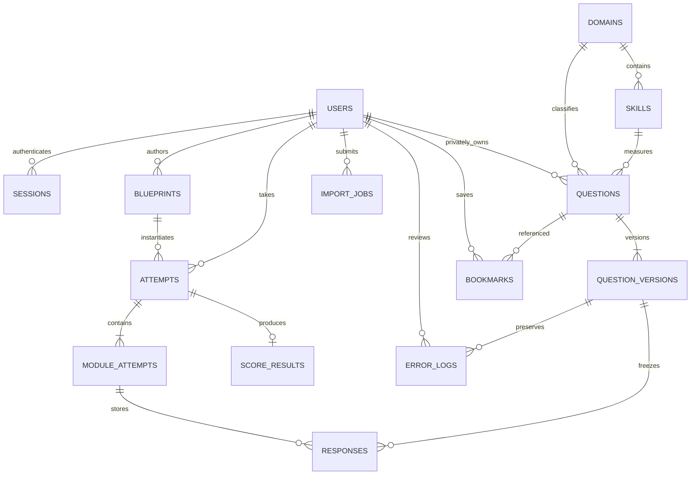

# Architecture

Pathwise is an independent Digital SAT self-study platform. Test mode follows the inspected local reference's focused header, split passage workspace, answer controls, navigator and fixed footer. Study mode provides the assess → analyze → practice → review → reassess loop.

The primary reference uses React/TypeScript/Vite. The implementation retains those technologies and KaTeX. Its missing license and unproven asset provenance prevent copying its source or fonts. The new code uses React 19, modern TypeScript/Vite, original CSS/SVG, system sans-serif UI and Georgia assessment text. The reference's mock API, browser token authentication, unsanitized HTML and transient annotations are replaced by a real backend.

## Boundaries

- `client/App.tsx`: secure-session startup, authentication, navigation and separate player route.
- `client/Study.tsx`: dashboard, custom practice, history, wrong-question journal and profile.
- `client/Bank.tsx`: paginated bank, versioned authoring, import preview/confirmation, manual and random blueprint editor, role management.
- `client/Player.tsx`: immediate local interactions and durable offline action queue; the server remains authoritative for deadlines, locking, routing and grading.
- `client/NotesResizeHandle.tsx`: accessible notes-panel width adjustment; passage and answer columns retain the original balanced layout.
- `client/NotesPanel.tsx`: inline notes rail, excerpt cards, note editing and the original combined pen/note icon.
- `client/AnnotationToolbar.tsx`: floating color and underline controls, deletion and Add note access.
- `client/RichText.tsx`: DOMPurify sanitization, KaTeX rendering and anchored annotation ranges.
- `client/Calculator.tsx`: movable/resizable calculator shell with an isolated Desmos v1.12 frame and original scientific/graph fallback.
- `client/desmos.ts`, `public/desmos-calculator.html` and `.js`: source-checked calculator bridge, official API loading and frame-only evaluation permission; configured through build-time environment values.
- `client/Report.tsx`: estimated results, question review and professional seven-segment print report.
- `server/app.ts`: Express API, security middleware, upload/import routes and production static hosting.
- `server/auth.ts`: bcrypt passwords, hashed database session tokens, HttpOnly cookies, CSRF and roles.
- `server/db.ts`: Knex database boundary and versioned portable migration; SQLite for local use, PostgreSQL via `DATABASE_URL`.
- `server/attempts.ts`: transactional, version-snapshotted module state machine. `server/attempt-lock.ts` serializes changes to the same attempt and uses database locks for PostgreSQL.
- `server/engines.ts`: pure seeded assembly, numeric grading, adaptive routing and internal scoring/performance calculations.
- `server/analytics.ts`: own-user history, errors, aggregate performance and transparent recommendations.
- `server/imports.ts`: CSV/XLSX/JSON parse, canonical column mapping, validation, preview, duplicates and confirmed import.
- `shared/types.ts`: contracts consumed by the client/server; the backend independently validates requests.

## Design choices

The schema normalizes identities, ownership, taxonomy, attempt/module/response relationships and question versions. Variable rich content, choices, assets, tags and immutable blueprint/report snapshots use JSON text in their parent records. This deliberately avoids unnecessary join tables for content that is always retrieved together. JSON text works in both SQLite and PostgreSQL. Domain and skill labels come from database records, seeded from official taxonomy.

Question edits append immutable versions. Each attempt captures the blueprint, original question versions, random seed, timing multiplier and adaptive configuration. Closed modules reject answers. Reports are stored once and are never silently rescored after code or content changes.

Browser persistence is a recovery buffer, not the account database. Queued answers are replayed through server validation. A full-test deadline continues through offline periods; expired modules transition at their actual boundaries. The player does not grant extra time after reconnecting. Practice can pause. Cookie tokens are never stored in localStorage.

Default deployment is a single Node process with a persistent SQLite volume. PostgreSQL and shared uploads suit multi-instance deployment. Native dependencies remain external to the server bundle. HTTPS terminates at a reverse proxy. No hard-coded browser API hostname is shipped; the frontend calls same-origin `/api`.

See [verification.md](verification.md) for actual tested surfaces. Architecture support does not imply a live PostgreSQL or Docker deployment was verified.
